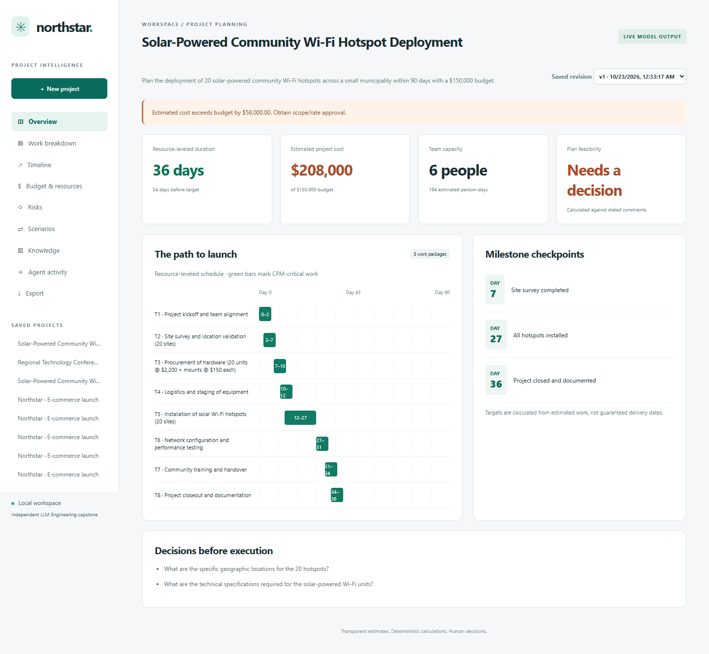
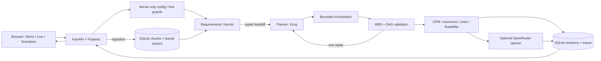

# Northstar · Agentic AI Project Manager

An independent LLM Engineering capstone with **verified live multi-provider planning**, deterministic project calculations, retrieval, persistent revisions and a responsive dashboard.

**Public source, local application. No public production deployment.** Original code and fictional examples are MIT licensed. No Wealth Advisor code or private assets were accessed.



## Live AI and Offline Demo

- **Live AI / multi-provider:** Gemini extracts requirements, Groq consumes the handoff and proposes a typed plan, Python validates/executes five tools, and an OpenRouter model independently reviews coverage and estimates. Actual model/request IDs, timings, validation and token usage appear in Agent activity. No simulated activity is presented as inference.
- **Live AI / single provider:** choose Gemini, Groq or OpenRouter for both requirements and planning. A second provider is not required. Gemini and Groq complete workflows were live-tested; OpenRouter was live-tested as the reviewer.
- **Offline Demo:** fixed fictional e-commerce fixture, no external calls. Same deterministic tools and persistence; it does not understand arbitrary goals.

## Run locally

Python 3.12+ is required. Node 24 is needed for browser tests only.

```sh
git clone https://github.com/Steveaub/agentic-ai-project-manager.git
cd agentic-ai-project-manager
python -m venv .venv
```

Activate `.venv` (`.venv\Scripts\Activate.ps1` on Windows; `source .venv/bin/activate` on macOS/Linux), then:

```sh
python -m pip install -r requirements-dev.txt
python -m uvicorn pm.api:app --host 127.0.0.1 --port 8000
```

Open **http://127.0.0.1:8000**. Offline Demo works immediately. If Python omits ensurepip, use `uv venv .venv` and `uv pip install --python .venv -r requirements-dev.txt`.

For live mode, create `.env` from `.env.example` **only if `.env` does not already exist**. Add provider keys locally, confirm the corresponding account/project has paid billing disabled, then set `PM_GEMINI_FREE_TIER_CONFIRMED=true` and/or `PM_GROQ_FREE_TIER_CONFIRMED=true`. Restart the backend. Never paste keys into the frontend, chat, commits, CI or screenshots.

The backend loads only this repository's `.env`; process environment takes precedence and interpolation is disabled. `/api/providers` reports models/readiness without keys. Missing settings produce actionable configuration errors.

## Verified defaults and free-only policy

| Role | Provider | Model |
|---|---|---|
| Requirements | Gemini Developer API | `gemini-3.5-flash-lite` |
| Planning / repair | Groq | `openai/gpt-oss-120b` |
| Independent review | OpenRouter | `nvidia/nemotron-3.5-super-vl:free` |
| Numerical calculations | Python | No model |

`PM_REQUIREMENTS_PROVIDER`, `PM_PLANNING_PROVIDER` and `PM_REVIEW_PROVIDER` configure roles (`none` disables review). Single-provider UI choices bypass multi-role assignments. Models are server-side allowlisted settings.

`PM_FREE_ONLY=true` and `PM_ALLOW_PAID_CALLS=false` block the retained OpenAI adapter. Groq/Gemini require operator confirmation of free-tier billing: their model names alone do not prevent charges. OpenRouter verifies current zero pricing and structured-output support before inference, uses a named `:free` model, enforces zero price ceilings and disables provider fallback. Optional explicit role fallbacks may use only verified free providers, default `none`, and share the four-call budget. No paid route, purchase or billing upgrade was enabled.

Actual tests informed defaults: Gemini 3.8 Flash timed out; Flash-Lite completed workflows. The older Nemotron 3 Super free route returned 404; 3.5 Super VL completed reviews with optional reasoning disabled. These are observations, not universal availability guarantees. [Configuration, research and error handling](docs/free-models.md).

## Agentic workflow and architecture

1. Requirements specialist extracts typed requirements, assumptions and questions from the goal, numeric constraints and untrusted retrieved passages.
2. Planner consumes that handoff, returning typed tasks, dependencies, milestones, estimates, risks and authorized operations.
3. Orchestrator validates schemas, provenance, references and DAGs, then invokes real WBS, CPM/resource-leveling, cost, resource and feasibility tools.
4. Invalid output permits one bounded repair. Optional independent review offers **AI opinions**, never overrides arithmetic, and may fail without discarding a valid calculated plan.
5. SQLite stores revisions, decisions, tool outputs and provider metadata. Sanitized failed-execution metadata is stored separately; failed planning does not mutate the project.



`config.py` loads settings; `providers.py` encapsulates adapters/budgets; `agents.py` coordinates roles/tools; `tools.py` owns deterministic math; `models.py` contracts; `store.py` memory/retrieval; `api.py` serves native JavaScript/CSS. No separate React/Next build or agent framework is needed.

Free workflows allow **four inference attempts total**, including repairs/fallbacks, 1,100 requested output tokens for requirements/review and 3,500 for planning/repair, up to 60 seconds per request and a boundary-checked 180-second workflow deadline. No automatic HTTP/SDK retries. Missing token usage is unavailable, not zero. These limits are not a service-wide quota.

Constraint-only revisions preserve baseline IDs, titles, grouping, effort, rates and fixed costs. Models revise risks/tradeoffs while Python recalculates feasibility; they cannot silently shrink estimates to fit a budget. Scope changes and task-level editing remain future work.

## Actual live validation

| Scenario | Observed result |
|---|---|
| Solar / Gemini only | Seven infrastructure tasks; 75 days / $241k; $91k over the $150k budget |
| Solar revision / Gemini | Same project/work; 60-day/$100k target; 15 days late and $141k over budget |
| Conference / Groq only | Eight conference tasks; 72 days / $64,800 against 120 days/$75k |
| Solar / three providers | Eight infrastructure tasks; 36 days / $208k; one malformed-JSON repair; OpenRouter review |
| Solar revision / three providers | Same project/work; 60-day/$100k target; 36 days / $208k, $108k shortfall |
| Conference / browser / three providers | Actual UI creation; nine tasks; 50 days / $120,400; $45,400 shortfall |

Every successful row executed five tools, validated output, saved state and recorded actual request IDs. These are model estimates, not verified quotes/delivery predictions or quality scores. Independent review can be wrong and is labeled accordingly; it receives computed schedule/budget context. [Live evidence and failures](docs/live-validation.md).

## Dashboard, retrieval and tests

Creation, overview, grouped WBS, timeline/dependency table, budgets/resources, risk register, scenarios, history, activity, text upload/search and JSON/CSV export work. Screenshots are authentic browser captures.

Knowledge accepts UTF-8 `.txt`/`.md`: 1,000-character chunks with 200-character overlap, normalized 512-dimensional word-hash vectors, SQLite storage and project-scoped cosine retrieval of four passages. Live revisions inject excerpts; Demo attaches them for review. This is **lexical**, not pretrained semantic retrieval. Limits: 100k characters/document and 500 chunks/project.

```sh
python -m pytest -q
python -m ruff check pm tests tools evaluations
python tools/check_secrets.py
node --check web/app.js
npm ci
npx playwright install chromium
# With the server running:
npm run test:e2e
```

Use `BROWSER_CHANNEL=chrome` for installed Chrome. CI runs mocked Python tests, lint, credential-pattern/history checks, syntax and offline browser tests using runner Chrome. **CI never receives provider keys or invokes live models.**

Local verification: **57 Python tests**, **13 offline browser assertions**, **15 saved-live-dashboard assertions**, plus real browser-driven live creation. Explicit live evaluators consume free quotas and never run automatically:

```sh
python evaluations/live_smoke.py solar --provider multi
python evaluations/live_smoke.py revision --provider multi --project-id <saved-id>
python evaluations/live_smoke.py conference --provider groq
# Optional real UI creation:
node evaluations/browser_live_create.cjs
```

## Limits and hosting

Local single-user software: no authentication, tenant isolation, HTTPS, at-rest encryption, global quotas, streaming jobs, cancellation or production monitoring. Do not expose it to the internet. Public hosting requires separate approval and production controls. Docker/loopback compose configuration is supplied but unexecuted.

Finish-to-start CPM plus stable greedy resource leveling is not optimal scheduling. Days are elapsed; resources are interchangeable, without skill calendars/holidays. No task-level editor, semantic embeddings or arbitrary-depth WBS exists. Human validation of estimates/review is essential. Direct Python dependencies are pinned, not every transitive. GitHub action runtime-migration warnings remain informational.

[Security](SECURITY.md) · [Architecture](docs/architecture.md) · [Evaluation](docs/evaluation.md) · [Live demo script](docs/demo-script.md) · [LinkedIn draft](docs/linkedin.md) · [Case study](docs/case-study.md)

This independent capstone is not represented as a formally required or graded course assignment.
