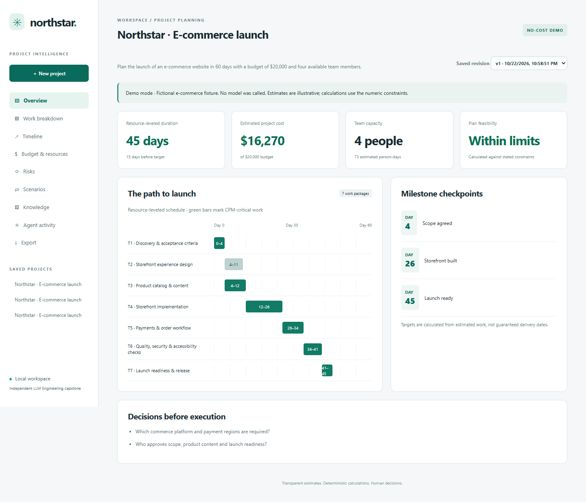
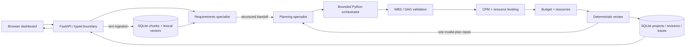

# Northstar · Agentic AI Project Manager

An independent LLM Engineering capstone that turns objectives and constraints into inspectable execution plans. Planning is separated from arithmetic, graph validation, tool authorization and persistence.

**Working local demo. Public source. Not a publicly deployed service.** No API key or paid call is needed for demo mode. The demo is a fixed fictional e-commerce fixture, clearly labeled throughout; it does not pretend to understand arbitrary goals.



## Try it locally

Python 3.12+ and Git are required. Node 24 is needed only for browser tests.

```sh
git clone https://github.com/Steveaub/agentic-ai-project-manager.git
cd agentic-ai-project-manager
python -m venv .venv
```

Activate `.venv` (`.venv\Scripts\Activate.ps1` on Windows; `source .venv/bin/activate` on macOS/Linux), then:

```sh
python -m pip install -r requirements-dev.txt
python -m uvicorn pm.api:app --host 127.0.0.1 --port 8000
```

Open **http://127.0.0.1:8000**. The frontend and backend share that origin. Use the default project and click **Build execution plan**. Do not bind this unauthenticated local application to a public interface.

If your Python distribution omits ensurepip, use `uv venv .venv` and `uv pip install --python .venv -r requirements-dev.txt` instead.

Optional local container path: `docker compose up --build`. It binds the host port to loopback and saves SQLite in a named volume. Container configuration is supplied but was not executed during development. Public production deployment requires separate approval and additional controls.

## What works

- Project creation, persistence, reopening, and immutable prior revisions with optimistic concurrency checks.
- Typed Pydantic contracts for goals, constraints, tasks, dependencies, milestones, resources, budgets, risks, decisions, invocations, results, scenarios and revisions.
- Five real allowlisted tools: WBS/dependency validation, CPM and resource-leveled scheduling, budget arithmetic, pooled resource utilization and deterministic review.
- Responsive dashboard, grouped WBS, timeline, budget/resources, risks, scenario comparison, knowledge, activity and JSON/CSV export.
- UTF-8 text/Markdown ingestion, overlapping chunks, local embeddings, SQLite vector storage, cosine retrieval, project metadata and source excerpts.
- An implemented OpenAI Responses structured-output path with a requirements-specialist → planning-specialist handoff, validated operations and one bounded repair.
- Versioned prompts, completed execution traces, model-call/token metrics, deadlines, retries disabled at the SDK, and per-run limits.

**Verification boundary:** demo flows and fake-transport live orchestration were tested. No paid model request was made. Live model behavior, semantic retrieval, Anthropic and production hosting are not verified or complete.

## Core demonstration

1. Create the e-commerce project using **60 days, $20,000, 4 people**.
2. Inspect seven work packages, dependencies, milestones, a **45-day schedule** and **$16,270 estimated cost**.
3. Upload `examples/fictional-charter.md` in Knowledge; search `payment requirements`.
4. In Scenarios, propose **46 days and $15,000**. Preview, then save a revision.
5. The same task IDs and estimates remain. The schedule has only **one day of buffer** and cost exceeds the new budget by **$1,270**. The app does not silently cut scope or rates to claim feasibility.
6. Switch saved revisions to inspect the original, then export full JSON or the latest tasks CSV.

Numeric input fields are authoritative constraints. Demo mode does not parse constraints from natural language or incorporate uploaded requirements into its fixed estimates. Retrieved passages are attached for human review; live revisions inject them into requirements analysis.

## What makes the live path agentic

The requirements specialist extracts a structured handoff from the goal, constraints and retrieved excerpts. The planning specialist consumes that handoff and proposes typed work packages and authorized operations. The Python orchestrator independently enforces operation order and calls real calculation functions. Invalid graphs or invalid task provenance can trigger one repair; a second invalid plan fails without saving a revision. The deterministic reviewer observes computed results and flags constraints. It is a software reviewer, not a third LLM agent.

The workflow is **plan → validate → execute → observe → evaluate → repair or finish**. It does not execute generated code, access arbitrary URLs, modify external projects, or autonomously perform the planned business work. Five tool steps, at most three model calls, 4,000 requested output tokens per call, 30-second per-call timeout and a boundary-checked 100-second workflow deadline limit each run. These are not a global spending cap or an exact dollar budget.

## Architecture



The no-cost fixture replaces both LLM specialists in demo mode; the same deterministic tools and storage still execute. `pm/models.py` owns contracts, `agents.py` prompts/providers/orchestration, `tools.py` calculations, `store.py` state/retrieval, and `api.py` HTTP. The frontend uses native JavaScript and CSS rather than a separate React/Next build, keeping the local vertical slice small and same-origin. There is no TypeScript compiler or ESLint step; JavaScript syntax and browser behavior are checked instead.

## Retrieval and memory

Project memory stores complete typed revisions as JSON in a separate SQLite table from document chunks. Chunks are 1,000 characters with 200-character overlap, carry source name/ordinal/ID, and store normalized 512-dimensional word-hash vectors. Search ranks up to four chunks by cosine similarity.

This is a functional **lexical retrieval-augmented planning path**, not pretrained semantic RAG. Hash collisions and vocabulary mismatch limit relevance. No embedding model or vector service is downloaded. A pretrained semantic embedding adapter and retrieval benchmark are explicit next steps. SQLite vector scans suit the enforced 500-chunk project limit, not a large knowledge base. All uploads and retrieved passages are untrusted; prompts cannot expand the tool allowlist.

## Optional live model configuration

Paid calls are off by default. Do not enable them without your own cost authorization. Set these environment variables **on the server process**, then restart the server:

```text
PM_ALLOW_PAID_CALLS=true
OPENAI_API_KEY=<your server-side API key>
OPENAI_MODEL=<a model available to your account that supports structured outputs>
```

Select OpenAI in project creation. The model is operator-configurable; no model was used for live inference during this build. `.env.example` lists safe placeholders; the application does **not** automatically load `.env`. Never put keys in the browser or commit them. Uploading documents for live revisions sends selected excerpts to the provider. Previewing and saving live scenarios are separate paid executions and can produce different results.

Implementation reference: [OpenAI structured outputs](https://developers.openai.com/api/docs/guides/structured-outputs). FastAPI selection follows its [official release notes](https://fastapi.tiangolo.com/release-notes/). Exact direct versions are pinned in requirements; all Python transitive dependencies are not locked. JavaScript browser-test dependencies have a lockfile.

## Tests and evaluation

```sh
python -m pytest -q
python -m ruff check pm tests
node --check web/app.js
npm ci
npx playwright install chromium
# With the server running in a separate terminal:
npm run test:e2e
```

To use installed Chrome instead of a downloaded Chromium, set `BROWSER_CHANNEL=chrome`. `PLAYWRIGHT_MODULE` can select an existing Playwright package. GitHub Actions runs Python checks and a fresh Chromium workflow, retaining screenshots as artifacts.

Actual local results: **30 Python tests passed** and **13 browser assertions passed, with zero page errors**. Tests cover known CPM/float values, cycles, missing references, resource contention, cost arithmetic, schema rejection, tool limits, specialist handoff/repair using a fake transport, persistence, revision conflicts, lexical retrieval/isolation, exports, origin checks and live-mode rejection. The browser checks creation, navigation, upload/search, preview/save, original-history restoration, reload, CSV download and 390px mobile overflow. Prompt-injection tests exercise deterministic confinement, not real-model prompt-injection resistance. See [evaluation record](docs/evaluation.md).

## Limits and next steps

- Live API requests and real-model prompt robustness need an explicitly authorized paid evaluation. Provider refusals/incomplete structured responses fail visibly; schema parsing failures do not currently enter the graph-repair loop.
- Only OpenAI plus the offline fixture are implemented. Anthropic/multi-model routing and semantic embeddings are not implemented.
- Revision comparison preserves task IDs; live estimates can change. There is no task-level editing screen, conversational constraint parser, scope-approval workflow or document-before-initial-planning UI.
- WBS has deliverable groups and leaf work packages, not arbitrary recursive summary tasks. Timeline uses bars and a dependency table, without arrow routing or drag editing.
- CPM uses finish-to-start relationships; resource leveling is stable greedy, not optimal. People are interchangeable, rates are fictional, days are elapsed, and taxes, holidays and skills are not modeled.
- Trace shows completed actions; there is no streaming, global token/dollar cap, persistent failed-run log, long-running job queue, cancellation or production monitoring.
- Local single-user service: no authentication, tenant authorization, encryption at rest, aggregate storage quota or rate limiter. Host/origin checks do not make it safe for internet exposure. See [security guidance](SECURITY.md).
- Docker configuration is unexecuted; production deployment and public hosting are not performed. Manual accessibility audit, Python transitive lock and broader browser coverage remain.

## Portfolio

[Architecture decisions](docs/architecture.md) · [Demo script](docs/demo-script.md) · [LinkedIn draft](docs/linkedin.md) · [Case study](docs/case-study.md) · [Release report](docs/release-report.md)

Original project code and fictional assets: MIT. No existing startup repository or private asset was accessed or reused. This independent capstone is not represented as a formally required or graded course assignment.
