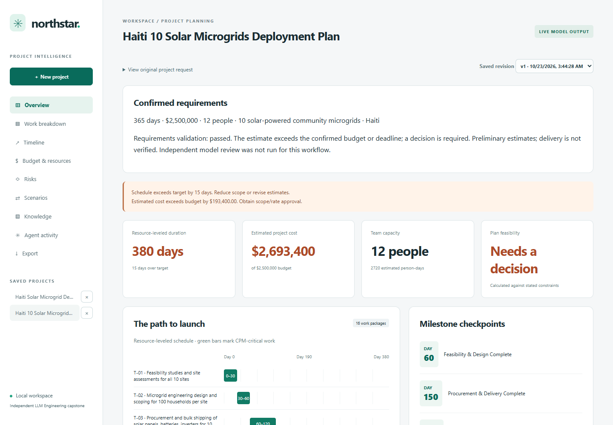
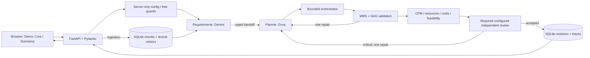

# Northstar · Agentic AI Project Manager

Northstar turns a natural-language project request into a confirmed scope, an estimated work plan, resource-leveled schedule, category budget and reviewable execution record. It is an **AI-assisted, local LLM Engineering capstone**, built around a practical lesson: schema-valid output can still solve the wrong problem.

The engineering boundary is explicit: **request → requirements confirmation → LLM planning → deterministic tools → independent review when configured → validation/one repair → saved plan**. Models suggest estimates; Python checks declared scope, dependencies, capacity and exact-cent arithmetic. Passing requirements validation does not mean a plan fits the budget or constitutes a delivery commitment.

**Public source; local demonstration; no public hosting.** All release acceptance calls are mocked. Existing sanitized live receipts are preserved, including failures and provider substitutions. [Final release evidence](docs/portfolio-release.md) · [Why the Haiti estimates differ](docs/estimate-comparison.md) · [Architecture](docs/architecture.md) · [90-second demo](docs/demo-script.md) · [LinkedIn draft](docs/linkedin.md).



## Live AI and Offline Demo

- **Live AI / multi-provider:** Gemini extracts requirements, Groq consumes the handoff and proposes a typed plan, Python validates/executes five tools, and an OpenRouter model independently reviews coverage and estimates. Actual model/request IDs, timings, validation and token usage appear in Agent activity. No simulated activity is presented as inference.
- **Live AI / single provider:** choose Gemini, Groq or OpenRouter for both requirements and planning. A second provider is not required. Gemini and Groq complete workflows were live-tested; OpenRouter was live-tested as the reviewer.
- **Offline Demo:** fixed fictional e-commerce fixture, no external calls. Same deterministic tools and persistence; it does not understand arbitrary goals.

## Run locally

Python 3.12+ is required. Node 24 is needed for browser tests only.

```sh
git clone https://github.com/Steveaub/agentic-ai-project-manager.git
cd agentic-ai-project-manager
python -m venv .venv
```

Activate `.venv` (`.venv\Scripts\Activate.ps1` on Windows; `source .venv/bin/activate` on macOS/Linux), then:

```sh
python -m pip install -r requirements-dev.txt
python -m uvicorn pm.api:app --host 127.0.0.1 --port 8000
```

Open **http://127.0.0.1:8000**. Offline Demo works immediately. If Python omits ensurepip, use `uv venv .venv` and `uv pip install --python .venv -r requirements-dev.txt`.

For live mode, create `.env` from `.env.example` **only if `.env` does not already exist**. Add provider keys locally, confirm the corresponding account/project has paid billing disabled, then set `PM_GEMINI_FREE_TIER_CONFIRMED=true` and/or `PM_GROQ_FREE_TIER_CONFIRMED=true`. Restart the backend. Never paste keys into the frontend, chat, commits, CI or screenshots.

The backend loads only this repository's `.env`; process environment takes precedence and interpolation is disabled. `/api/providers` reports models/readiness without keys. Missing settings produce actionable configuration errors.

## Verified defaults and free-only policy

| Role | Provider | Model |
|---|---|---|
| Requirements | Gemini Developer API | `gemini-3.5-flash-lite` |
| Planning / repair | Groq | `openai/gpt-oss-120b` |
| Independent review | OpenRouter | `nvidia/nemotron-3.5-super-vl:free` |
| Numerical calculations | Python | No model |

`PM_REQUIREMENTS_PROVIDER`, `PM_PLANNING_PROVIDER` and `PM_REVIEW_PROVIDER` configure roles (`none` disables review). Single-provider UI choices bypass multi-role assignments. Models are server-side allowlisted settings.

`PM_FREE_ONLY=true` and `PM_ALLOW_PAID_CALLS=false` block the retained OpenAI adapter. Groq/Gemini require operator confirmation of free-tier billing: their model names alone do not prevent charges. OpenRouter verifies current zero pricing and structured-output support before inference, uses a named `:free` model, enforces zero price ceilings and disables provider fallback. Optional explicit role fallbacks may use only verified free providers, default `none`, and share the six-call budget. No paid route, purchase or billing upgrade was enabled.

Actual tests informed defaults: Gemini 3.8 Flash timed out; Flash-Lite completed workflows. The older Nemotron 3 Super free route returned 404; 3.5 Super VL completed reviews with optional reasoning disabled. These are observations, not universal availability guarantees. [Configuration, research and error handling](docs/free-models.md).

## Agentic workflow and architecture

1. Extract explicit budget, duration, team size, site quantity/location and mandatory deliverables. Review proposed scope and conflicts in the confirmation dialog. Missing values stay blank; request values replace differing UI defaults. Contradictory prose and changes to explicit requirements require an explanation.
2. Persist an immutable confirmed requirements record. Live creation and constraint amendments require a matching confirmation ID. The same values reach specialists, tools, results and exports. Historical live plans display a validation warning.
3. A requirements specialist expands assumptions/questions. A separate labor-rate call receives scope/location with the budget withheld. The planner uses that rate and separates equipment, materials, logistics, permitting and contingency from calculated labor.
4. Validate confirmed scope/constraints, mandatory coverage, every site's installation/verification, verification dependencies, fixed-cost reconciliation, labor provenance and DAG/capacity. Site installation packages can overlap; shared procurement is separate. Durations and costs remain unverified estimates.
5. In the configured specialist workflow, OpenRouter returns severity, finding type and corrections. Critical requirements/semantic findings trigger one shared repair and re-review. Unresolved critical findings, meaningless review text or required-review outages block saving. Subjective estimate concerns remain labeled opinions; honest budget/schedule overruns remain visible calculated exceptions.
6. SQLite stores accepted revision snapshots and sanitized failure metadata. Live amendments retain baseline work/rates/costs and require confirmation bound to that project, revision and change request. Single-provider mode runs the deterministic gate without an independent provider review.



`config.py` loads settings; `providers.py` encapsulates adapters/budgets; `agents.py` coordinates roles/tools; `tools.py` owns deterministic math; `models.py` contracts; `store.py` memory/retrieval; `api.py` serves native JavaScript/CSS. No separate React/Next build or agent framework is needed.

Free workflows allow **six inference attempts total**, including the budget-blind rate estimate, repairs, reviews and explicit free fallbacks. Requested output caps are 1,800 tokens for requirements/rate estimation, 3,500 for review and 6,500 for planning/repair; requests time out after at most 60 seconds, with a boundary-checked 300-second workflow deadline. There is one shared repair, no automatic HTTP/SDK retries, and no paid route. A provider's free quota can still block a workflow. Missing token usage is unavailable, not zero.

Constraint-only revisions preserve baseline IDs, titles, grouping, effort, rates and fixed costs. Models revise risks/tradeoffs while Python recalculates feasibility; they cannot silently shrink estimates to fit a budget. Scope changes and task-level editing remain future work.

## Saved live execution, accurately scoped

| Confirmed Haiti input | Actual providers | Observed estimate |
|---|---|---|
| Short ten-site request | Gemini planning + OpenRouter review; one repair | 13 tasks, 200 days, $2,171,600 |
| Expanded 100-household/equipment request | Gemini only; no independent review | 16 tasks, 380 days, $2,693,400; 15 days late and $193,400 over budget |

These are saved actual executions, not fresh release calls. Both use 365 days / $2.5M / 12 people; the cost differences reflect changed effort/scope assumptions. Neither is a vendor quote. [Comparison](docs/estimate-comparison.md) and [requirements/live evidence](docs/requirements-validation.md) explain the limits. Historical solar/conference experiments remain in [the development archive](docs/live-validation.md), not as currently validated portfolio examples. Groq failures and a rejected provisional review are preserved.

## Dashboard, retrieval and tests

Creation, overview, grouped WBS, timeline/dependency table, budgets/resources, risk register, scenarios, history, activity, text upload/search and JSON/CSV export work. Screenshots are authentic browser captures.

Knowledge accepts UTF-8 `.txt`/`.md`: 1,000-character chunks with 200-character overlap, normalized 512-dimensional word-hash vectors, SQLite storage and project-scoped cosine retrieval of four passages. Live revisions inject excerpts; Demo attaches them for review. This is **lexical**, not pretrained semantic retrieval. Limits: 100k characters/document and 500 chunks/project.

```sh
python -m pytest -q
python -m ruff check pm tests tools evaluations
python tools/check_secrets.py
node --check web/app.js
npm ci
npx playwright install chromium
# With the server running:
npm run test:e2e
```

Use `BROWSER_CHANNEL=chrome` for installed Chrome. CI runs mocked Python tests, lint, credential-pattern/history checks, syntax and offline browser tests using runner Chrome. **CI never receives provider keys or invokes live models.**

Release verification: **92 Python tests** and **110 browser assertions** across six executed scripts. CI runs the 80 assertions that need no preloaded saved database; 30 saved-live assertions are additionally run locally. See [release evidence](docs/portfolio-release.md). Use mocked tests and saved receipts for routine demonstrations. `evaluations/live_microgrids.py` is an explicit optional free-quota-consuming evaluator, not part of CI; its confirmation is a labeled automated fixture. No live quota was consumed for this release.

Local single-user software: no authentication, tenant isolation, HTTPS, at-rest encryption, global quotas, streaming jobs, cancellation or production monitoring. Do not expose it to the internet. Public hosting requires separate approval and production controls. Docker/loopback compose configuration is supplied but unexecuted.

Finish-to-start CPM plus stable greedy resource leveling is not optimal scheduling. Days are elapsed; resources are interchangeable, without skill calendars/holidays. No task-level editor, semantic embeddings or arbitrary-depth WBS exists. Human validation of estimates/review is essential. Direct Python dependencies are pinned, not every transitive. GitHub action runtime-migration warnings remain informational.

[Security](SECURITY.md) · [Architecture](docs/architecture.md) · [Evaluation](docs/evaluation.md) · [Live demo script](docs/demo-script.md) · [LinkedIn draft](docs/linkedin.md) · [Case study](docs/case-study.md)

This independent capstone is not represented as a formally required or graded course assignment.

## Requirements consistency regression

The Haiti regression and acceptance policy are documented in [requirements validation results](docs/requirements-validation.md). Run `python -m pytest -q` and `BROWSER_CHANNEL=chrome node tests/browser-requirements.cjs` for offline checks. `python evaluations/live_microgrids.py` explicitly consumes free inference quota and records the exact 10-site / $2.5M / 365-day / 12-person scenario. Its confirmation is an automated test fixture, not a human confirmation.

Extraction is deliberately conservative: supported numeric/word day, week and year durations, USD budget amounts, team counts, named site quantities and `must include` clauses. Unsupported phrasing remains an open question; review the full goal and proposed deliverables before confirming. Cost estimates and model semantic judgments require human engineering/commercial validation.

## Release reliability and project management

PR #1 retains the current project's budget in scenarios; the final release also retains its current deadline/team and uses neutral change text. Any change is explicit before confirmation. Delete buttons act on one selected project only, with a permanent-deletion dialog and stale-revision protection. Names are not deduplicated: repeated Demo titles represent distinct creation records. Associated data is removed transactionally; shared confirmations are retained while referenced.

Fallback is opt-in: set `PM_PLANNING_FALLBACK_PROVIDER=gemini` in your local environment to allow a free Gemini alternative to Groq planning and repair. `PM_REPAIR_FALLBACK_PROVIDER=none` explicitly disables repair fallback. No setting was silently enabled for this release. Every attempt consumes the existing six-attempt budget; fallback does not guarantee enough capacity remains for repair/re-review. Actual successful planner metadata is recorded separately from configured roles. End-to-end mocked HTTP tests verify success, failure, budget exhaustion and paid-route rejection; automatic failover has not been newly verified against live quotas.

Older solar/conference screenshots and receipts are historical development evidence. Use the portfolio screenshots and the two explicitly confirmed Haiti snapshots for the current showcase. The $2.17M short request and $2.69M expanded request are not interchangeable scope baselines. No unsupported cost estimate is presented as a quotation.
