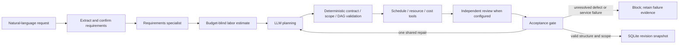

# Architecture and engineering decisions

Confirmed requirements are immutable records, bound to goal and constraints. Amendment confirmations also bind to project, baseline revision and change request. Explicit request constraints cannot be replaced by form defaults. Labor estimation deliberately receives scope/location without the available budget. Pydantic schemas constrain structure; separate validation checks scope, site coverage, verification dependencies, provenance and exact-cent cost reconciliation. Python owns finish-to-start CPM, greedy pooled-resource leveling and cost arithmetic. A feasible calculation is not a verified engineering commitment; an infeasible estimate can be saved honestly as needing a decision.

The service is FastAPI, Pydantic, SQLite and native JavaScript/CSS. Provider adapters isolate fixed HTTPS endpoints, wire schemas and sanitized errors. Gemini uses native generateContent; Groq and OpenRouter use chat-completion interfaces. Configured specialist roles normally use Gemini/Groq/OpenRouter respectively. Actual per-attempt provider/model records, rather than configured role labels, identify substitutions. Single-provider mode does not run independent provider review and says so in the UI.

One WorkflowSession shares six budgeted attempts across roles, fallback and repair. Each configured provider attempt counts, including configuration/catalog failures; actual inference attempts are reported separately. There is at most one plan repair. Requests have a 60-second cap within a boundary-checked 300-second workflow deadline. Fallback is off by default. Explicit `PM_PLANNING_FALLBACK_PROVIDER=gemini` also applies to repair unless `PM_REPAIR_FALLBACK_PROVIDER` explicitly overrides it (including `none`). Model allowlists, confirmed free-tier billing and OpenRouter zero-price catalog/routing checks apply to every attempt. No paid fallback or automatic billing change is permitted. Fallback plus repair/re-review can exhaust six attempts; failure then blocks saving rather than expanding the budget.

Independent review returns a substantive summary, verdict, typed severity/findings and corrections. Critical requirement/semantic defects or an explicit repair verdict can trigger one repair/re-review. Empty or meaningless output is not a pass. Subjective estimate concerns remain opinions, separate from deterministic failures. Sources and generated content are untrusted data. Tools are restricted to five fixed operations; no model-proposed code executes.

Revision updates use optimistic compare-and-swap. Failed calls never append accepted revisions. Deletion requires explicit confirmation and expected revision, then atomically removes one project's snapshots, chunks, associated failure history and exclusive requirement records. Shared confirmations remain while another project references them. Unbound initial failure/draft records cannot safely be attributed to a deleted project and are retained. There is no title-based deletion or bulk cleanup.

The sidebar scrolls independently on desktop and remains accessible on mobile. Lists, tables and review cards are primary; JSON is collapsed audit detail. Portfolio replay uses separate local SQLite data copied from saved receipts, preserving real development history. Document retrieval uses lexical word-hash vectors and project-scoped cosine search, not semantic embeddings.

Local single-user software only: no authentication/tenant isolation, durable job queue, global quota, secret vault, skill-calendar scheduling or public production hosting. SDK/HTTP automatic retries are disabled. Provider availability and model semantic judgments remain fallible.
