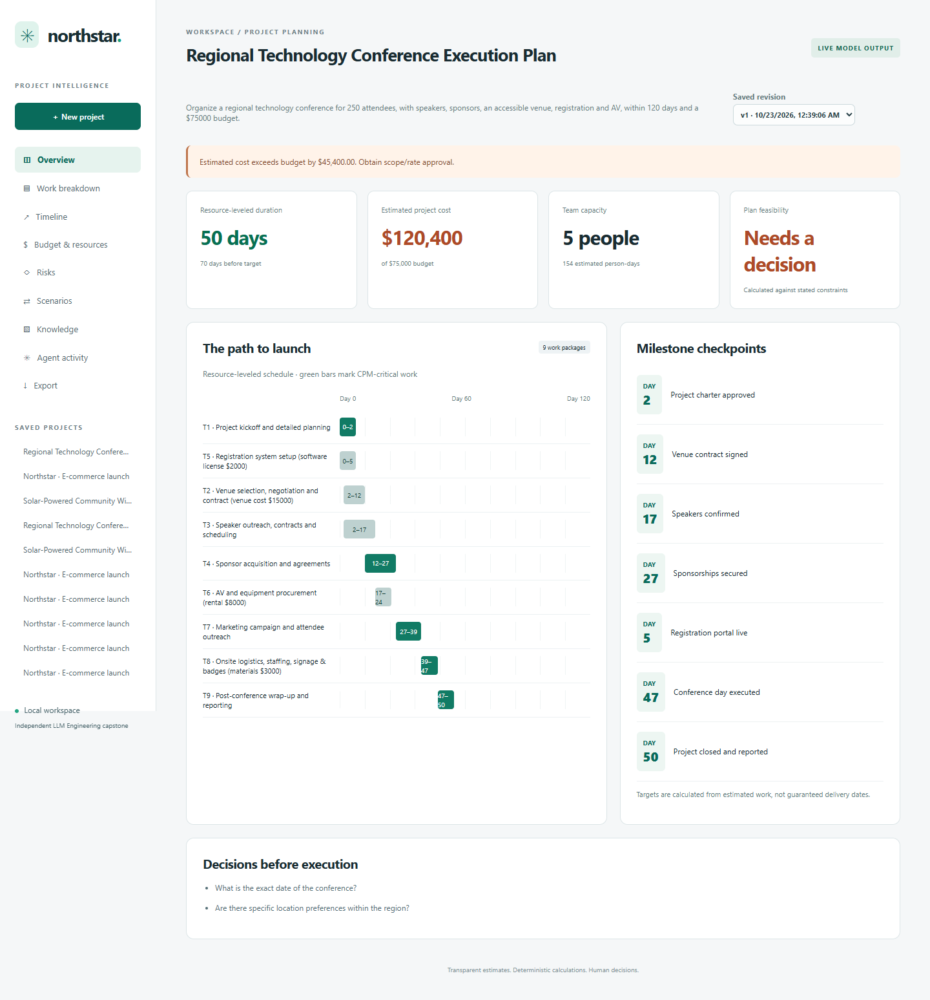
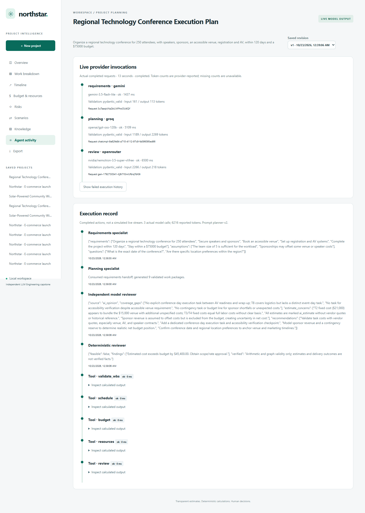

# Real live validation — October 23, 2026

Six successful fictional workflows were executed locally using the owner's confirmed free-tier
Groq/Gemini accounts and zero-price OpenRouter routing. No paid mode, paid fallback, credits,
billing change or public hosting was enabled. Account billing status is owner-confirmed;
the application does not claim to have audited provider billing ledgers.

| Run | Provider roles | Tasks | Calculated days | Estimated USD | Duration |
|---|---|---:|---:|---:|---:|
| Solar initial | Gemini requirements/planning | 7 | 75 | 241,000 | 4.78 s |
| Solar revision | Gemini requirements/planning | 7 | 75 | 241,000 | 4.67 s |
| Conference | Groq requirements/planning | 8 | 72 | 64,800 | 6.80 s |
| Solar initial | Gemini → Groq → OpenRouter | 8 | 36 | 208,000 | 11.81 s |
| Solar revision | Gemini → Groq → OpenRouter | 8 | 36 | 208,000 | 6.78 s |
| Conference, created through browser/API | Gemini → Groq → OpenRouter | 9 | 50 | 120,400 | 13.05 s |

Exact models: `gemini-3.5-flash-lite`, `openai/gpt-oss-120b`, and
`nvidia/nemotron-3.5-super-vl:free`. Successful workflow records contain **16 successful
provider invocations**, plus one rejected Groq planning attempt repaired within its workflow.
Diagnostic probes and earlier failed workflows are recorded separately; 16 is not a claim
that only 16 inference attempts occurred during debugging. All calls used the free-only policy.

Every successful workflow ran the five deterministic tools and persisted the project. Solar
plans contain survey, equipment procurement for 20 units, solar installation, network testing,
handover and infrastructure risks rather than storefront work. Conference plans contain venue,
speaker/sponsor, registration and AV work. Pydantic and DAG validation passed for saved plans.

Both revisions kept the original project ID, appended a new revision, and preserved task IDs,
titles, duration, people, rates and fixed costs. The Gemini revision at 60 days/$100k reported
15 days late and $141k over budget. The three-provider revision retained 36 days/$208k and
reported a $108k deficit. Constraint changes alone did not manufacture cheaper/faster work.

The scenarios do not establish estimate realism: model-produced costs and durations differ,
and no vendor quotes or engineering site survey verified them. These are observed outputs,
not quality scores or an apples-to-apples provider benchmark. Independent review is an opinion,
not numerical authority. An early review questioned schedule feasibility despite the calculated
schedule; its context was expanded to include budget items, resources and computed schedule.
The final browser-created conference used this expanded context and completed successfully.

## Genuine failures observed

- Gemini 3.8 Flash: authenticated model listing succeeded but inference timed out in two full
  workflow attempts and a native API probe. No project was saved by those failures.
- Groq: requirements succeeded while an early plan response was rejected as malformed JSON.
  Structural diagnostics revealed invalid JSON despite the requested strict schema. Prompt
  instructions now require plain numeric literals, and server JSON rejections enter the single
  bounded repair. The three-provider solar workflow exercised that repair successfully.
- OpenRouter: prior Nemotron 3 Super free route returned 404. The 3.5 Super VL planning probe
  was truncated with reasoning enabled; optional reasoning was disabled for bounded JSON
  review. Independent reviews then succeeded with zero-price guards enforced.

## Browser and automated checks

- **57 Python tests passed**: adapters, malformed output, schema handling, free-only controls,
  explicit fallbacks, missing/invalid configuration, timeouts, status codes, role handoff,
  bounded repairs, failed-revision integrity, existing deterministic tools, memory and retrieval.
- **13 offline browser assertions passed**, zero page errors.
- **15 saved-live-dashboard assertions passed**, zero page errors and zero extra inference calls.
- Actual live conference creation passed through browser controls → HTTP POST → all three
  providers → tools → SQLite → dashboard, with zero page errors.
- Ruff and browser JavaScript syntax checks passed.

The offline browser suite runs in CI without keys. Live scripts are explicit manual tools and
consume free quota. Container execution, public hosting, global service quotas, security of an
internet deployment and broad live prompt-injection robustness have not been verified.

## Evidence

[Sanitized request receipts](live-validation.json) include timestamps, actual request IDs,
provider/model/role, status, duration, reported tokens and validation, without keys or raw
provider errors. The nine workflow records comprise six successes and three failures.
Failed-request usage can be missing; do not interpret reported totals as complete consumption.

[Preserved two-revision solar example](../examples/live-solar.json).

